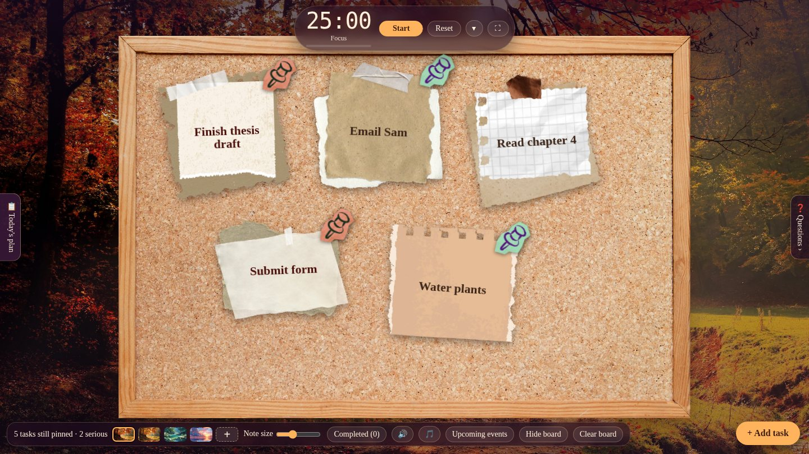

# Lockin Notes 🍂

A cosy autumn study desk in your browser: a focus timer, a cork pin board for today's tasks, and boards for your daily plan, upcoming deadlines and questions for your teacher. Everything runs on one web page, with no account and no install.

**Live site:** https://haydenwork321-del.github.io/Lockin-notes/

## Features

### Timer
- **Pomodoro and custom countdown:** Focus (25 min), Short break (5), Long break (15), or set your own minutes. Every fourth focus session moves on to a long break.
- **Floating timer:** drag it anywhere on the page. It also shows in the browser tab title.
- **Full-screen focus mode:** the **⛶** button opens a big distraction-free timer with a progress ring. It uses your browser's full screen where available and keeps the screen awake.

### Sticky-note pin board
- **Pin notes:** add a task, choose a paper style, and drag it anywhere on the cork board.
- **Colour-coded pins:** a green pin for simple tasks, a red pin for serious ones, and no pin for normal ones. Click the **●** on a note to change it.
- **Edit and resize:** edit text, make a single note bigger or smaller, or use the **Note size** slider for all of them.
- **Completed list:** ticking a note peels it off the board and saves it under **Completed**. Restore or delete it whenever you like.
- **Hide board:** fade the board away to enjoy the scenery.

### Other boards (swipe or use the edge tabs)
- **📋 Today's plan (swipe right or ←):** a time-and-task schedule with a progress bar. It highlights the next item, turns late ones red, and carries unfinished items over to the next day.
- **❓ Questions (swipe left or →):** questions to ask the teacher, tagged with who they're for. Tick one off once asked and write down the answer.
- **Upcoming events (flip button or `F`):** the back of the board. Add exams and deadlines, mark the important ones with a ★, and choose how early to be reminded.
- **Calendar:** open the 📅 button on the events side. Days with events get dots, and clicking a day filters the list.
- **Reminders:** events close to their date pop up as message-style notifications on the front board.
- Everything can be edited after adding with the **✎** button or a double-click.

### Look and sound
- **Scenes:** four backgrounds, plus your own pictures with the **+** button.
- **Sound effects:** pinning, moving and completing notes each have their own sound. Mute them with **🔊**.
- **Background sound:** a fireplace loop with its own volume, under the **🎵** button.

## Keyboard shortcuts

| Key | What it does |
| --- | --- |
| `F` | Flip the board to upcoming events and back |
| `H` | Hide or show the board |
| `←` / `→` | Open Today's plan / Questions, and come back |
| `Space` | Start or pause (in full-screen focus mode) |
| `Esc` | Close a popup, or leave focus mode |

Most of these pause while you're typing in a box.

## Your data

Everything you add is saved **only in your own browser** (localStorage and IndexedDB). Nothing is sent to a server.

- It stays when you close the page.
- It does not sync between devices or browsers.
- It disappears if you clear site data or use a private window.
- Custom backgrounds you add stay on your device and are never uploaded.
- Don't put passwords or private information in your notes.

The page uses [GoatCounter](https://www.goatcounter.com/) to count visits. It sets no cookies.

## Run it yourself

This is a single self-contained file. There's nothing to build or install.

1. Download `index.html`.
2. Double-click it to open it in your browser.

The handwriting fonts load from Google Fonts, so they need an internet connection. Offline you'll see a plain fallback font.

### Publish on GitHub Pages
1. Put `index.html` in a public repository.
2. Go to **Settings → Pages**.
3. Under **Build and deployment**, choose **Deploy from a branch**, then **main** and **/ (root)**, and save.
4. After a minute or two the site is live at `https://YOUR-USERNAME.github.io/REPO-NAME/`.

## Built with

Plain HTML, CSS and JavaScript, with no frameworks and no build step. All images and sounds are embedded in the page, which is why the file is about 11 MB.

## Credits

Please check and fill in the sources and licences before sharing this project widely.

- **Fonts:** [Caveat](https://fonts.google.com/specimen/Caveat), [Fraunces](https://fonts.google.com/specimen/Fraunces) and [Spline Sans Mono](https://fonts.google.com/specimen/Spline+Sans+Mono) from Google Fonts.
- **Forest photo:** from [Pexels](https://www.pexels.com/) (photographer: valiphotos).
- **Other backgrounds** (painted forest, stream, sunrise): _add source and licence_
- **Note papers, tape and pin stickers:** _add source and licence_
- **Pin board and board back:** _add source and licence_
- **Sound effects and fireplace loop:** _add source and licence_

Third-party images and audio belong to their creators.

## License

_Add a licence for the code, for example by adding a `LICENSE` file (MIT is a common choice). Third-party artwork and audio keep their own licences, as listed above._
